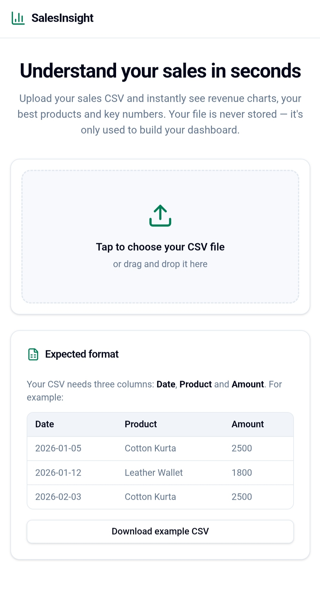
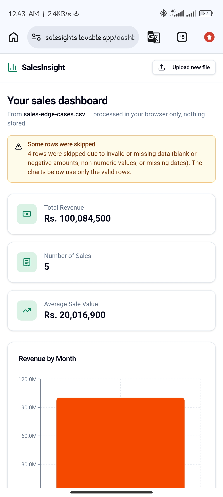
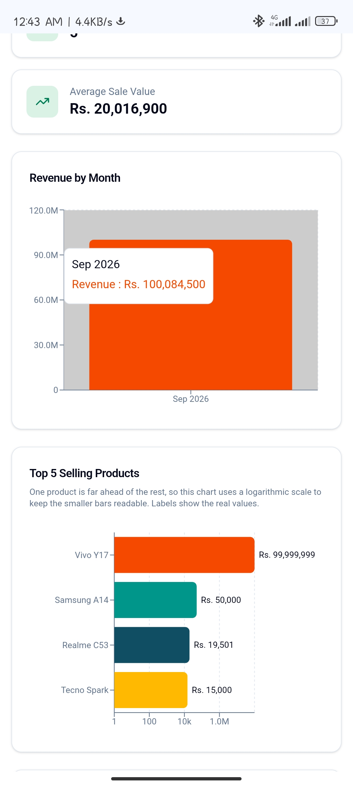
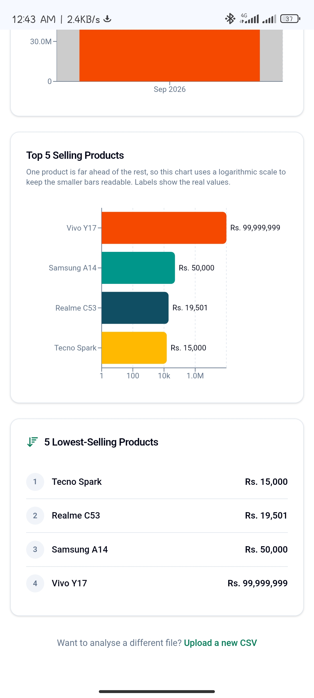
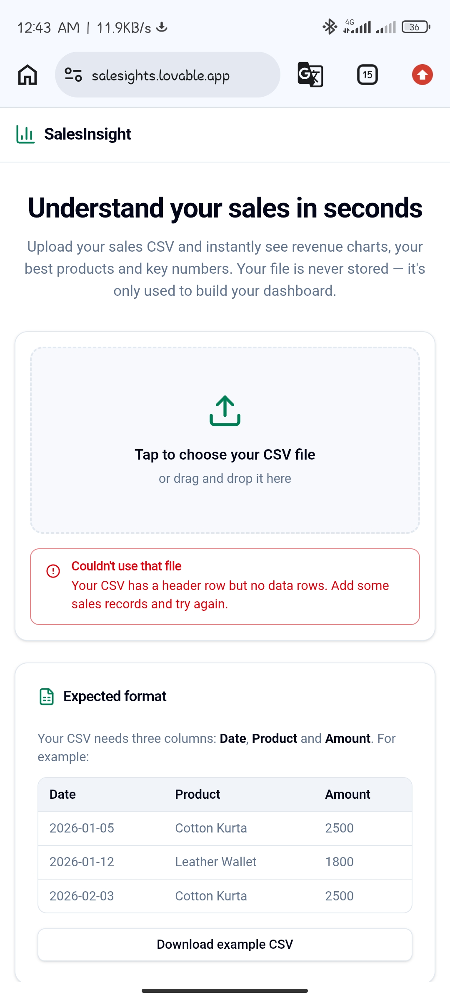

# SalesInsight

A mobile-friendly web app that lets small business owners upload a sales CSV file and instantly see revenue insights, without needing Excel or manual chart-making. Just upload your CSV and the dashboard appears in seconds — nothing is stored, so your data stays private.

## Screenshots

**Dashboard Overview**

**Upload with Data Validation**

**Top Selling Products**

**Lowest Selling Products**

**Empty Data Handling**

## Features

- CSV upload with example format guidance
- Automatic summary: total revenue, number of sales, average sale value
- Revenue by month chart
- Top 5 selling products chart
- Lowest 5 selling products list
- Data is processed only for display — not permanently stored, for privacy

## Data Validation & Testing

This project was manually tested with both clean and intentionally broken data, including blank values, negative amounts, non-numeric values, missing dates, duplicate rows, and extreme outlier values. Invalid rows are excluded from calculations and the user is shown how many rows were skipped. Extreme outlier values are handled so smaller data points remain visible on charts. Uploading a file with no data shows a clear message instead of an error or blank page.

## Tech Stack

- **TanStack Start** (TanStack Router) — full-stack React framework with file-based routing
- **React 19** with TypeScript
- **Vite** — build tooling and dev server
- **Tailwind CSS v4** — styling with a custom design-token theme
- **shadcn/ui** (Radix UI + lucide-react) — accessible UI components and icons
- **Recharts** — revenue and product charts
- **Papa Parse** — CSV parsing and validation in the browser
- **Bun** — package management

## Live App

https://salesights.lovable.app

Built with Lovable.
